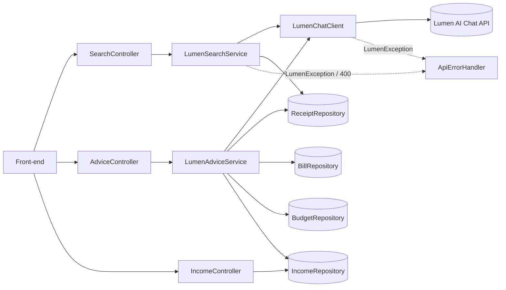
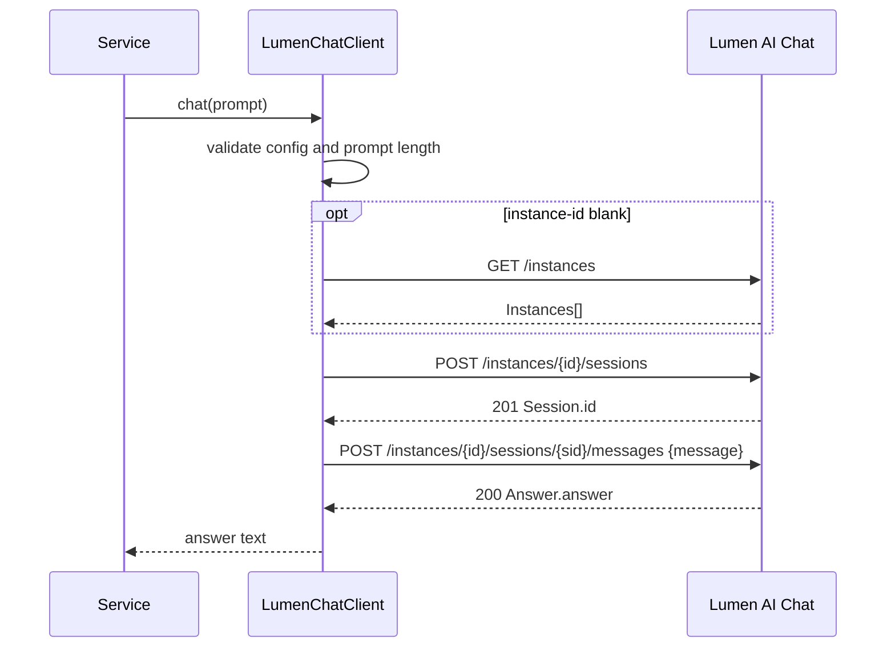

# Design Document

## Overview

This feature adds Lumen AI Chat access to the Klaro backend (Spring Boot 4, Java 21, Spring Data JPA, `RestClient`). It delivers two capabilities and one supporting record type:

- Natural-language search: Lumen turns a query into a `SearchFilter`. Klaro runs the filter against its own database. No record data goes to Lumen.
- Budgeting advice: Klaro gathers income, receipts, bills and budgets, sends a budgeted summary to Lumen in one message, and returns the advice as a list of strings.
- Income records: a new `Income` entity with a REST controller supplies the income data.

All Lumen traffic goes through one class, `LumenChatClient`. It follows the `LumenOcrClient` conventions: `RestClient`, `lumen-api-key` / `lumen-api-secret` headers, `@Value`-injected settings. Failures raise `LumenException`, which `ApiErrorHandler` maps to JSON errors. `SimpleSearchService` and `StubAdviceService` are deleted, so no fallback path exists.

### The Lumen AI Chat API

- Base URL (`Chat_Base_URL`): the Lumen gateway origin plus `/ai_chat`, for example `https://api.staging.nonlive.lumen.bayanichain.tech/ai_chat`. The API exists on test and staging gateways only.
- Auth: headers `lumen-api-key` and `lumen-api-secret`. The key needs the AI Chat grant. No Bearer or OAuth.
- Flow per call:
  1. `GET {Chat_Base_URL}/instances` returns `{"Instances":[{"InstanceID","Name","Description","Status"}]}`. Skipped when `klaro.lumen.chat.instance-id` is set.
  2. `POST {Chat_Base_URL}/instances/{instanceId}/sessions` returns 201 with `{"Session":{"id":...}}`. The body is empty or has an optional `title` (1 to 200 chars).
  3. `POST {Chat_Base_URL}/instances/{instanceId}/sessions/{sessionId}/messages` with `{"message": "..."}` (at most 4000 chars) returns 200 with `{"Answer":{"answer":"..."}}`.
- There is no system prompt or role field. Instructions and data share the single `message`.
- The answer is free text. Structured output is extracted from it.

### Design Decisions

- One client method, `String chat(String prompt)`. It resolves the instance, creates a fresh session, sends the message and returns `Answer.answer`. Services own prompt wording and output parsing.
- Stateless: a new session per call, and the session id is a local variable only. No stale or foreign session can be reused (a session belongs to the creating key and one instance).
- The old assumption of a `messages` array payload and a configurable chat path is removed. The payload is `{"message": ...}` and the path structure is fixed by the API.
- Lumen failures keep their Lumen status and error code so callers see why a call failed. Only 429, 503 and 504 pass through to the caller. Everything else is 502.
- Search filtering uses a JPA `Specification`, so only present fields apply. `ReceiptRepository` also extends `JpaSpecificationExecutor<Receipt>`.
- Dates use ISO-8601 (`yyyy-MM-dd`). Today's date goes in the search prompt so Lumen can resolve phrases such as "last month".
- Length is measured with `String.length()` (UTF-16 units). That is never less than the character count Lumen sees, so staying within 4000 here is safe.

## Architecture





Error flow: `LumenChatClient` and the services throw `LumenException`. It propagates through the controller to `ApiErrorHandler`, which returns a JSON body. Nothing catches it and calls a placeholder.

## Components and Interfaces

### LumenChatClient (`com.klaro.service`)

```java
@Component
public class LumenChatClient {

    public static final int MESSAGE_LIMIT = 4000;

    public LumenChatClient(
            @Value("${klaro.lumen.chat.base-url:}") String chatBaseUrl,
            @Value("${klaro.lumen.chat.instance-id:}") String instanceId,
            @Value("${klaro.lumen.api-key:}") String apiKey,
            @Value("${klaro.lumen.api-secret:}") String apiSecret) {
        // RestClient with 10s connect timeout and 30s read timeout
    }

    /** Opens a new session, sends the prompt as one message, returns Answer.answer. */
    public String chat(String prompt) {
        requireConfigured();                       // credentials, chat base URL
        requireValidLength(prompt);                // not blank, <= MESSAGE_LIMIT
        try {
            String instance = resolveInstanceId();
            String session  = createSession(instance);   // new session every call
            return sendMessage(instance, session, prompt);
        } catch (LumenException e) {
            throw e;
        } catch (RestClientResponseException e) {        // non-2xx
            throw LumenErrors.fromResponse(e.getStatusCode().value(), e.getResponseBodyAsString());
        } catch (RestClientException e) {                // network error / read timeout
            throw LumenException.unreachable();
        }
    }

    String resolveInstanceId() { /* property if not blank, else first of GET /instances */ }
    String createSession(String instanceId) { /* POST .../sessions, read Session.id */ }
    String sendMessage(String instanceId, String sessionId, String prompt) { /* POST .../messages {"message":prompt}, read Answer.answer */ }
}
```

Notes:
- `klaro.lumen.chat.base-url` is separate from the OCR `klaro.lumen.base-url`. It resolves from `LUMEN_CHAT_BASE_URL` and holds origin plus `/ai_chat`. A trailing slash is trimmed.
- Credentials come from the existing `klaro.lumen.api-key` / `api-secret` properties, which resolve from `LUMEN_API_KEY` / `LUMEN_API_SECRET`. Nothing is committed.
- Every request (instances, sessions, messages) goes through a single `authenticate(HttpHeaders)` that sets `lumen-api-key` and `lumen-api-secret`. No `Authorization` header is set.
- Session creation sends an empty JSON object, so the optional `title` is omitted.
- `resolveInstanceId`: a non-blank property is returned as is, with no call to `/instances`. Otherwise the client calls `GET /instances` and takes `Instances[0].InstanceID`. An empty list raises `LumenException(SERVICE_UNAVAILABLE, "No Lumen chat instance is available.")`.
- Response parsing uses Jackson `JsonNode`. A body that is not JSON, or lacks `Session.id`, `Answer.answer` or `Instances`/`InstanceID` where needed, raises `LumenException` "Lumen returned an invalid response." (502).
- The session id is never stored in a field. It is passed down the call chain and dropped when `chat` returns or throws.
- Request building and response parsing for all three routes live in this class only. Helper methods are package-private for unit tests.
- Config and length checks run before any network call.

### LumenException (`com.klaro.service`)

```java
public class LumenException extends RuntimeException {
    private final HttpStatus httpStatus;   // status returned by Klaro to the caller
    private final Integer lumenStatus;     // HTTP status received from Lumen, or null
    private final String lumenCode;        // Lumen error code, or null

    public LumenException(HttpStatus httpStatus, String message, Integer lumenStatus, String lumenCode) { ... }
    public LumenException(HttpStatus httpStatus, String message) { this(httpStatus, message, null, null); }
    // getters, plus static factories: unreachable(), invalidResponse(), invalidMessageLength(), ...
}
```

### Lumen error mapping (`LumenErrors`, package-private, used by the client)

`LumenErrors.fromResponse(int status, String body)` reads the error code from the body. It tries JSON fields `code`, `Code`, `error_code`, `errorCode` and `error.code`, and treats the code as absent if none parse. It then maps as follows.

| Lumen status | Lumen code | Message | Klaro HTTP status |
|---|---|---|---|
| 403 | `ACCESS_DENIED`, `VIEW_ONLY_ACCESS` | The API key lacks the AI Chat grant. | 502 |
| 403 | `API_CREDITS_INSUFFICIENT` | Lumen API credits are insufficient. | 502 |
| 403 | `LC_INSUFFICIENT` | Lumen LC balance is insufficient. | 502 |
| 403 | `SESSION_NOT_OWNED` | The Lumen session is not owned by this API key. | 502 |
| 404 | any, including `SESSION_NOT_FOR_INSTANCE` | Unknown Lumen instance or session. | 502 |
| 409 | `AI_CHAT_CONFLICT` | Lumen chat conflict. | 502 |
| 429 | `AI_CHAT_MODEL_RATE_LIMITED` | The Lumen model is rate limited. | 429 |
| 502 | `AI_CHAT_MODEL_UPSTREAM_ERROR` | Lumen model upstream error. | 502 |
| 503 | `AI_CHAT_MODEL_UNAVAILABLE`, `AI_CHAT_NOT_CONFIGURED`, `FEATURE_DISABLED`, `PERMISSIONS_UPDATING` | Lumen AI Chat is unavailable. | 503 |
| 504 | `AI_CHAT_REPLY_TIMEOUT` | Lumen reply timed out. | 504 |
| any other non-2xx | any or none | Lumen returned HTTP {status}. | 429/503/504 pass through, otherwise 502 |

Rules:
- Every `LumenException` built here carries `lumenStatus = status` and `lumenCode = code` (null if none).
- The Klaro HTTP status is derived from the Lumen status alone: `status in {429, 503, 504} ? status : 502`. This holds even when the code is unrecognized. Messages are chosen by status and code, and a message always names the code when one exists.
- Local failures (missing credentials, blank chat base URL, invalid message length, no instance, unreachable, invalid response) have no Lumen status. Their statuses: credentials missing 503, chat base URL missing 503, no instance 503, invalid message length 400 (never reaches Lumen), unreachable 502, invalid response 502.

### ApiErrorHandler additions

```java
@ExceptionHandler(LumenException.class)
public ResponseEntity<Map<String, Object>> lumenFailed(LumenException ex) {
    Map<String, Object> body = new LinkedHashMap<>();
    body.put("error", ex.getMessage());
    if (ex.getLumenStatus() != null) body.put("lumenStatus", ex.getLumenStatus());
    if (ex.getLumenCode() != null)   body.put("lumenCode", ex.getLumenCode());
    return ResponseEntity.status(ex.getHttpStatus()).body(body);
}

@ExceptionHandler(BadRequestException.class)   // blank or over-long search query
public ResponseEntity<Map<String, String>> badRequest(BadRequestException ex) {
    return ResponseEntity.badRequest().body(Map.of("error", ex.getMessage()));
}
```

`BadRequestException` is a small runtime exception for query validation. Income validation reuses the existing `MethodArgumentNotValidException` handler (400 with `errors`).

### SearchFilter (`com.klaro.dto`)

```java
@JsonIgnoreProperties(ignoreUnknown = true)
public record SearchFilter(String merchant, LocalDate startDate, LocalDate endDate, String category) {}
```

All fields are optional. `category` is a string so an out-of-range value is detected by the service, not by Jackson.

### JSON filter extraction (`JsonObjectExtractor`, package-private)

The answer is free text, so the service extracts the filter instead of parsing the whole answer.

```java
static Optional<JsonNode> firstObject(String text, Predicate<JsonNode> accept)
```

Algorithm:
1. Scan `text` for `{` characters. For each, find the matching `}` with a depth counter that is aware of JSON string literals and escapes, so braces inside strings do not count.
2. Try to parse each balanced candidate with Jackson. The first candidate that parses to an object and satisfies `accept` is returned.
3. Markdown code fences (```` ```json ... ``` ````) need no special handling, because the scan skips over the fence markers and surrounding prose and only looks at braces. Candidates are tried in order of appearance.
4. If no candidate qualifies, return empty.

For search, `accept` is "the object has at least one of the keys `merchant`, `startDate`, `endDate`, `category`", so an unrelated JSON snippet in the prose is skipped. An object with all values `null` is a valid empty filter. Unknown keys are ignored.

### LumenSearchService (`com.klaro.service`)

Implements `SearchService` (`List<Receipt> search(String query)`), annotated `@Service`.

Steps:
1. If `query` is null or blank, throw `BadRequestException("Search query must not be blank.")`. The client is not called.
2. If `query.length() > MAX_QUERY_LENGTH`, throw `BadRequestException("Search query is too long. The maximum length is " + MAX_QUERY_LENGTH + " characters.")`. The client is not called.
3. Build the single message with `buildPrompt(query)`. It states the task, lists the allowed `Category` names, gives today's date, and asks for only a JSON object with `merchant`, `startDate`, `endDate`, `category` (`null` for fields absent from the query). The query comes last. It contains no record data.
4. Call `chat(prompt)`. Extract the filter with `JsonObjectExtractor`, then map to `SearchFilter`. No qualifying object, or a field that cannot be mapped (for example a date that is not ISO-8601), throws `LumenException.invalidResponse()`.
5. Validate: a non-blank `category` must match a `Category` value (case-insensitive), otherwise throw invalid response. If `startDate` and `endDate` are both present and `startDate` is after `endDate`, throw invalid response.
6. Build a `Specification<Receipt>` from the present fields and call `receipts.findAll(spec)`.

Prompt budget:
- `MAX_QUERY_LENGTH = MESSAGE_LIMIT - buildPrompt("").length()`, computed once. Today's date always has 10 characters, so the overhead is constant.
- Therefore `buildPrompt(q).length() <= 4000` exactly when `q.length() <= MAX_QUERY_LENGTH`. A query of exactly `MAX_QUERY_LENGTH` is accepted.

Specification semantics:
- merchant: case-insensitive "contains" on `merchant`
- startDate: `receiptDate >= startDate`
- endDate: `receiptDate <= endDate`
- category: equals the parsed `Category`
- fields combine with AND. An empty filter matches all receipts. No match gives an empty list.

Package-private helpers (`buildPrompt`, `parseFilter`, `validate`, `toSpecification`) keep the logic testable without a Lumen call.

### Income (`com.klaro.model`)

```java
@Entity
public class Income {
    @Id @GeneratedValue(strategy = GenerationType.IDENTITY) private Long id;
    @NotBlank private String source;
    @NotNull @Positive @Column(precision = 12, scale = 2, nullable = false) private BigDecimal amount;
    @Column(length = 3, nullable = false) private String currency = "PHP";
    @NotNull private LocalDate receivedDate;
    // getters and setters, same style as Bill
}
```

`IncomeRepository extends JpaRepository<Income, Long>`.

### IncomeController (`/api/income`)

| Method | Path | Behavior |
|---|---|---|
| GET | `/api/income` | Returns all Income records |
| POST | `/api/income` | `@Valid` body; saves and returns the Income with its id; 400 on validation failure |
| DELETE | `/api/income/{id}` | 204 on success; 404 if the id does not exist |

This follows the `BillController` shape, without get-by-id or update since the requirements do not ask for them.

### LumenAdviceService (`com.klaro.service`)

Implements `AdviceService` (`List<String> advise()`), annotated `@Service`.

Steps:
1. Load `incomeRepo.findAll()`, `receipts.findAll()`, `bills.findAll()` and `budgets.findAll()`.
2. Build one message with `AdvicePromptBuilder.build(income, receipts, bills, budgets)` (below). It is always sent, including when all collections are empty.
3. Call `chat(message)` and parse the answer into a `List<String>`: split on newlines, strip bullet or number prefixes (`-`, `*`, `1.`, `1)`), trim, and drop empty lines.

`AdviceController` and the `List<String>` response type are unchanged.

### AdvicePromptBuilder (package-private)

The message is `HEADER + SECTIONS`, where:
- `HEADER` holds the advice instructions (ask for one recommendation per line, plain text, no preamble) and is fixed text.
- Each of the four sections (Income, Receipts, Bills, Budgets) has a title line, an aggregate line, and zero or more item lines. Items hold only the fields advice needs (for example merchant, date, amount, category). `rawText` is never included.
- Aggregate lines: count and total amount for Income, Receipts and Bills, and count and total limit for Budgets. They are short and bounded in length.

Budgeting algorithm (`build`):
1. Render the full message with all items. If `length <= MESSAGE_LIMIT`, return it.
2. Otherwise render the minimum message: header plus each section's title and aggregate line, with no items. The header and aggregates are bounded, so this always fits in 4000. (Unbounded text, such as free-text names, is truncated to a fixed length inside item lines and never appears in aggregate lines.)
3. Sort each collection by date, most recent first. Add items round-robin across the four sections, most recent first, one item at a time, keeping an item only if the message stays at or under `MESSAGE_LIMIT`. When an item does not fit, stop adding to that section. Continue until no section can add another item.
4. Render with the chosen items, listed most recent first within each section, and return it.

Result: the message never exceeds 4000 characters, always contains the instructions and every aggregate, and when items are dropped the kept items in each section are the most recent ones (a prefix of the date-descending order).

### Removals and configuration

- Delete `SimpleSearchService` and `StubAdviceService`. `LumenSearchService` and `LumenAdviceService` become the only `SearchService` and `AdviceService` beans. No code path calls them after a `LumenException`.
- `ReceiptRepository` adds `JpaSpecificationExecutor<Receipt>`.
- `application.properties` adds the following. The earlier `klaro.lumen.chat.path` property is removed.

```properties
# --- Lumen AI Chat (natural-language search and budgeting advice) ---
# Gateway origin + /ai_chat, e.g. https://api.staging.nonlive.lumen.bayanichain.tech/ai_chat
# Separate from the OCR base URL above. Not available on live gateways.
klaro.lumen.chat.base-url=${LUMEN_CHAT_BASE_URL:}
# Leave blank to use the first instance returned by GET /instances.
klaro.lumen.chat.instance-id=${LUMEN_CHAT_INSTANCE_ID:}
```

## Data Models

```
Income(id: Long, source: String, amount: BigDecimal > 0, currency: String(3) = "PHP", receivedDate: LocalDate)
SearchFilter(merchant?: String, startDate?: LocalDate, endDate?: LocalDate, category?: String)
```

Lumen messages:

```json
// POST .../sessions            -> 201
{"Session": {"id": "sess-123"}}

// POST .../sessions/{id}/messages
{"message": "<instructions and query or data, at most 4000 chars>"}
// -> 200
{"Answer": {"answer": "Here is the filter:\n```json\n{\"merchant\":\"Jollibee\",\"startDate\":\"2025-01-01\",\"endDate\":\"2025-01-31\",\"category\":\"FOOD\"}\n```"}}
```

Klaro error response (Lumen and 400 errors):

```json
{"error": "The Lumen model is rate limited.", "lumenStatus": 429, "lumenCode": "AI_CHAT_MODEL_RATE_LIMITED"}
{"error": "Search query is too long. The maximum length is 3800 characters."}
```

## Error Handling

| Condition | Klaro status | Body |
|---|---|---|
| API key or secret blank | 503 | error: Lumen credentials are not configured |
| Chat base URL blank | 503 | error: Lumen chat base URL is not configured |
| Prompt blank or over 4000 chars (client) | 400 | error: invalid message length; no Lumen call |
| No instance available | 503 | error: No Lumen chat instance is available |
| Lumen 429, 503, 504 | same as Lumen | error, lumenStatus, lumenCode |
| Other Lumen non-2xx (403, 404, 409, 502, ...) | 502 | error, lumenStatus, lumenCode |
| Network error or read timeout (30s) | 502 | error: Lumen is unreachable |
| Unparseable response, missing `Session.id` / `Answer.answer` | 502 | error: Lumen returned an invalid response |
| No filter JSON in answer, unknown category, start after end, bad date | 502 | error: Lumen returned an invalid response |
| Blank search query | 400 | error: Search query must not be blank |
| Search query over the maximum length | 400 | error: states the maximum length |
| Invalid Income | 400 | `{"errors": {field: message}}` (existing handler) |
| Delete missing Income | 404 | empty body |

Logging: the client logs the Lumen status, code and underlying exception message at WARN. Prompts, answers, API keys and secrets are not logged.

## Testing Strategy

Dual approach: unit tests for examples and wiring, property-based tests for the properties below. Property tests use jqwik (a JUnit 5 property-based testing library for Java), each with at least 100 iterations (`@Property(tries = 100)`), tagged `Feature: lumen-ai-integration, Property N: <title>`. jqwik is added as a test-scope dependency with a pinned version.

- Client tests use `MockRestServiceServer` bound to the client's `RestClient.Builder`, recording every request. Service tests use a Mockito mock or stub of `LumenChatClient`. No real Lumen call is made.
- Repository-backed properties (search filtering, Income) use `@DataJpaTest` or an in-memory H2 context. Filtering is also checked against a plain in-memory predicate as the model.
- Prompt-building properties are pure functions and need no Spring context.
- Example and smoke tests:
  - Property values `klaro.lumen.chat.base-url` and `klaro.lumen.chat.instance-id` are read, the old `klaro.lumen.chat.path` is gone, and the read timeout is 30 seconds (1.1, 1.2, 1.4, 1.7).
  - Empty `Instances` list raises the no-instance error (2.3).
  - Session creation omits `title` (3.2).
  - Simulated network error and read timeout return "unreachable" (4.12).
  - Search with an unparseable date returns invalid response (5.8); a search matching nothing returns an empty list (5.9).
  - Advice with no data still calls the client (7.6); the advice endpoint path and type are unchanged (7.7).
  - The application context has exactly one `SearchService` and one `AdviceService`, both Lumen-backed, and the placeholder classes no longer exist (4.16, 8.1 to 8.3).

## Correctness Properties

*A property is a characteristic or behavior that should hold true across all valid executions of a system-essentially, a formal statement about what the system should do. Properties serve as the bridge between human-readable specifications and machine-verifiable correctness guarantees.*

### Property 1: Credentials on every request

For any valid prompt, any configured credentials, and any instance configuration, every HTTP request the client sends (instances, sessions and messages) carries the `lumen-api-key` and `lumen-api-secret` headers with the configured values and carries no `Authorization` header.

**Validates: Requirements 1.3**

### Property 2: Configured instance id is used without listing

For any non-blank `klaro.lumen.chat.instance-id` and any prompt, the client sends no `GET /instances` request, and the session and message requests use that instance id in their paths.

**Validates: Requirements 2.1**

### Property 3: Blank instance id resolves to the first instance

For any non-empty list of instances returned by `GET /instances` and a blank `klaro.lumen.chat.instance-id`, the session and message requests use the `InstanceID` of the first instance in the list.

**Validates: Requirements 2.2**

### Property 4: One new session per call, and the answer is returned

For any sequence of N valid prompts sent through the client, each with any returned session id and any answer text, the client creates exactly N sessions (one per call), each message is posted to the session created for that same call with a body whose `message` equals the prompt, and each call returns exactly the `Answer.answer` text. No session id from an earlier call appears in a later call.

**Validates: Requirements 3.1, 3.3, 3.4, 3.5, 3.6**

### Property 5: Invalid message length is rejected locally

For any prompt that is blank or longer than 4000 characters, the client raises a `LumenException` indicating an invalid message length and sends no HTTP request. For any non-blank prompt of at most 4000 characters, the prompt is sent unchanged.

**Validates: Requirements 3.7**

### Property 6: Missing configuration is rejected before any request

For any prompt, and any configuration where the API key is empty, the API secret is empty, or the chat base URL is blank, the client raises a `LumenException` stating which setting is not configured and sends no HTTP request.

**Validates: Requirements 4.1, 4.2**

### Property 7: Lumen errors map to status, code and the pass-through rule

For any Lumen error response with any non-success HTTP status and any error code (including the documented codes, unknown codes and no code), the client raises a `LumenException` whose `lumenStatus` equals the response status and whose `lumenCode` equals the response code. Its message contains the code when one was returned. Its Klaro HTTP status equals the Lumen status when that status is 429, 503 or 504, and is 502 otherwise. For the documented status and code pairs, the message describes the condition listed in the mapping table.

**Validates: Requirements 4.3, 4.4, 4.5, 4.6, 4.7, 4.8, 4.9, 4.10, 4.11, 4.15**

### Property 8: Malformed Lumen responses are rejected

For any successful Lumen response body that is not JSON, or is JSON lacking the `Session.id` field (session route) or the `Answer.answer` field (message route), the client raises a `LumenException` indicating an invalid Lumen response with Klaro status 502.

**Validates: Requirements 4.13**

### Property 9: Lumen errors become JSON error responses

For any `LumenException` with any Klaro status, message, optional Lumen status and optional Lumen code, the error handler returns that Klaro status with a JSON body whose `error` field equals the message, whose `lumenStatus` field is present exactly when a Lumen status exists, and whose `lumenCode` field is present exactly when a Lumen code exists, with equal values.

**Validates: Requirements 4.14**

### Property 10: Search message is within the limit and carries the query only

For any query that is non-blank and at most the maximum query length, and any set of stored receipts, the message sent to the client has a length of at most 4000 characters, contains the query, and contains no stored receipt merchant, amount or raw text beyond text that is part of the query or fixed instructions. A query of exactly the maximum length is accepted.

**Validates: Requirements 5.1, 5.11, 5.12**

### Property 11: Over-long and blank queries are rejected with 400

For any query longer than the maximum query length, search returns an HTTP 400 error whose message states the maximum query length. For any null, empty or whitespace-only query, search returns HTTP 400 with an error message. In both cases the client is not called.

**Validates: Requirements 5.10, 5.11**

### Property 12: Filter JSON extraction round trip

For any `SearchFilter` and any surrounding text (including empty text, prose before and after, braces in the prose, and an optional Markdown code fence with or without a `json` tag), serializing the filter, embedding it in that text and extracting returns an equal filter. For any text with no JSON object that parses as a filter, extraction fails with an invalid Lumen response.

**Validates: Requirements 5.2, 5.3**

### Property 13: Search results equal the filter's matching receipts

For any set of stored receipts and any valid `SearchFilter`, the search result is exactly the set of receipts that satisfy every present field (merchant contains, ignoring case; date on or after start; date on or before end; category equal). A filter that matches nothing returns an empty list.

**Validates: Requirements 5.4, 5.9**

### Property 14: Category matching against the enum

For any `Category` value in any letter case, validation accepts it and the resulting specification matches only receipts in that category. For any non-blank string that is not a `Category` name (ignoring case), search raises a `LumenException` indicating an invalid Lumen response.

**Validates: Requirements 5.5, 5.6**

### Property 15: Inverted date ranges are rejected

For any pair of dates where the start date is later than the end date, search raises a `LumenException` indicating an invalid Lumen response. For any pair where the start date is on or before the end date, validation accepts the pair.

**Validates: Requirements 5.7**

### Property 16: Income create, list and delete round trip

For any valid Income, creating it returns the Income with a non-null id, listing then includes it, and deleting it by that id removes it from later listings.

**Validates: Requirements 6.1, 6.2, 6.3, 6.4**

### Property 17: Invalid Income is rejected and not stored

For any Income with a blank or missing source, a missing date, or an amount that is zero or negative, the endpoint returns 400 with an error message and the stored Income count is unchanged.

**Validates: Requirements 6.5**

### Property 18: Deleting an unknown Income returns 404

For any identifier that does not belong to a stored Income, a delete request returns 404 and stored Income is unchanged.

**Validates: Requirements 6.6**

### Property 19: Advice message never exceeds the limit

For any sets of Income, Receipts, Bills and Budgets (including all empty and very large sets, and long text fields), `advise` sends exactly one message to the client, and that message has a length of at most 4000 characters and contains the advice instructions.

**Validates: Requirements 7.2, 7.3, 7.6**

### Property 20: Advice message budgeting keeps aggregates and the most recent items

For any sets of Income, Receipts, Bills and Budgets, the advice message contains the aggregate count and total for each of the four kinds. When the full rendering fits within 4000 characters, the message contains an entry for every item. When it does not fit, the message contains only items that are, within each kind, a most-recent-first prefix of that kind's items by date, and no omitted item is more recent than an included item of the same kind.

**Validates: Requirements 7.1, 7.2, 7.4**

### Property 21: Advice text parses to a list of lines

For any list of non-empty advice strings, formatting them as lines with optional bullet or number prefixes and parsing the result returns the same list, with no empty entries.

**Validates: Requirements 7.5**
